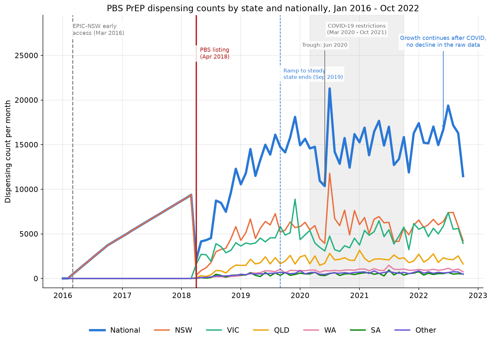
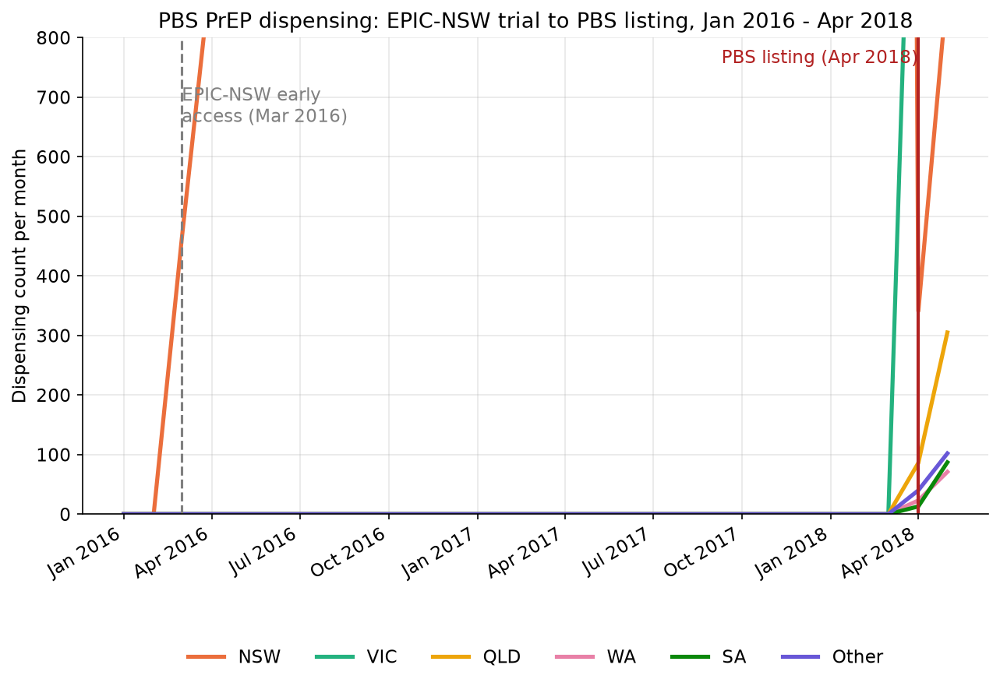

# Data exploration: PBS PrEP dispensing

A direct look at the national and state-level PrEP dispensing series, ahead of 
modelling. This is dataset-level evidence shared across stages, not specific to one
identification strategy. See `docs/scope_and_rationale.md` for the full four-stage
causal design.

## National and state-level dispensing patterns

Does the data actually show the large, obvious level shift the project's causal
argument depends on? It does. Before the April 2018 listing, every state except
NSW sits at zero (NSW is the one exception, addressed below); afterward, national
dispensing rises from about 2,100 in April 2018 to over 10,000 a month within a
year. Three further patterns are visible without any modelling:

- **Post-listing growth is not a straight line.** It climbs sharply through
  mid-to-late 2018, then keeps climbing into 2019, reaching the 11,000-18,000 a
  month range by late 2019 without ever settling into a clear plateau, a shape a
  single linear post-listing term cannot capture on its own.
- **A COVID-19 dip, trough in June 2020.** National dispensing falls from a
  late-2019 average of about 15,500 a month to 10,348 in June 2020, about
  two-thirds of that level. Victoria's own dip is far deeper than any other
  state's: comparing April-August 2020 to each state's own late-2019 average,
  Victoria falls to about two-thirds of its baseline while every other state
  stays roughly flat or higher, consistent with Victoria's extended lockdowns.
  The recovery afterward is noisy rather than smooth, and national dispensing at
  the series end in October 2022 (11,472) remains below its late-2019 average.
- **NSW is already elevated before the national listing.** Its line separates
  from the other states well before April 2018, which is the first visual hint
  that the "before" period isn't as flat as a simple before/after comparison
  would assume.

## NSW pre-trend

Figure 2 zooms into January 2016 to April 2018, on a y-axis scaled to the
pre-listing range rather than the full national scale, where NSW's ramp would be
visually dwarfed by the much larger post-listing values. NSW's dispensing climbs
steadily from 0 in March 2016 to
9,375 by March 2018, entirely before the national PBS listing, while every other
state stays at zero across the same period. This is the intended EPIC-NSW signal,
not a data artefact, see `reports/data_acquisition.md` for how this period is
constructed.
