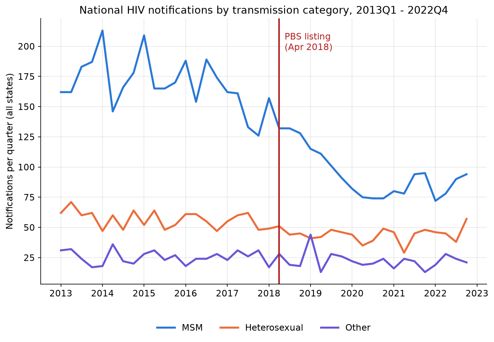

# HIV notifications: data exploration

A direct look at the HIV notification series by transmission category, ahead of any
modelling.

## National notifications by transmission category

Three patterns are visible without any modelling:

- **MSM is both the largest category and the one that declines.** National MSM
  notifications run at 150-215 a quarter through 2013-2017, fall sharply from
  2018 to a low of 74-95 a quarter in 2020-2021, then recover slightly to
  around 90-95 by 2022. Heterosexual notifications stay in a comparatively
  narrow 30-60 a quarter band across the whole period, with no comparable
  break; Other stays lower still, 13-36 a quarter, similarly flat.
- **The unconditional before/after gap is much larger for MSM.** Averaging
  per state-transmission-quarter cell, MSM notifications fall from 28.2 before
  April 2018 to 15.8 after, a 44% relative drop; the Heterosexual/Other cells
  combined fall from 6.8 to 5.6, a 19% relative drop. This is the raw signal
  Stage 2's difference-in-differences estimate formalises, the 44% vs. 19%
  gap net of each group's own trend is the quantity of interest, not either
  figure alone.
- **MSM's decline is visibly underway before April 2018, and it is an NSW
  effect.** The national MSM line is already falling through 2014-2017, well
  before the PBS listing. Splitting by state confirms why: NSW's own MSM
  notifications fall 22% from a 2013-15 average (56.6 a quarter) to a 2016-17
  average (44.1), while the rest of the country's MSM notifications fall only
  2.2% over the same window (118.9 to 116.3 a quarter). This is the same
  EPIC-NSW pre-trend `reports/pbs_prep_dispensing_data_exploration.md` found
  in dispensing, now visible in the outcome data too, and it matters here
  more directly: Stage 2's planned specification pools all states under a
  single April 2018 cutoff, so part of what a naive national MSM/comparison
  split would attribute to the PBS listing is really NSW's earlier,
  separately-timed decline. Stage 3's staggered-adoption design exists
  precisely to treat NSW's earlier start as its own source of variation
  rather than let it contaminate a single national break test.

## What this means for Stage 2's specification

The pre-trend finding does not rule out a DiD design, but it means Stage 2's
`C(state)` term in `hiv_notifications ~ is_msm * post_pbs_listing + C(state) +
C(quarter)` only controls for each state's average level, not for NSW's
differently-timed MSM trend. **Decision: Stage 2 excludes NSW**, the same
resolution Stage 1 used for dispensing, testing the rest-of-country aggregate
so a single April 2018 cutoff isn't contaminated by NSW's earlier,
separately-timed decline. Recomputing the unconditional group means on that
rest-of-country population: MSM falls 41.7% (23.6 before April 2018 to 13.7
after) against 20.3% for the comparison group (5.7 to 4.5), both close to the
all-states figures above, confirming NSW's exclusion sharpens rather than
reverses the raw signal.
