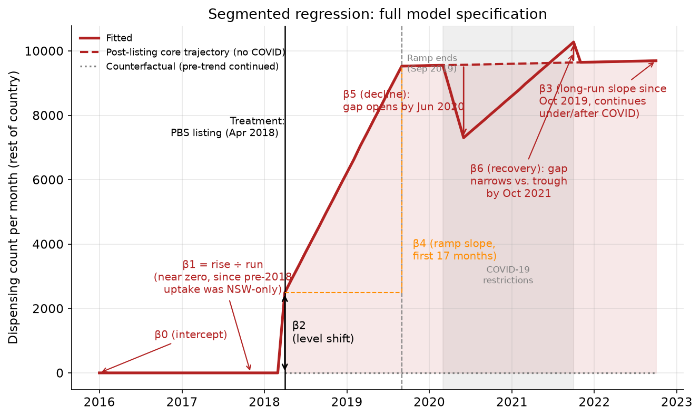
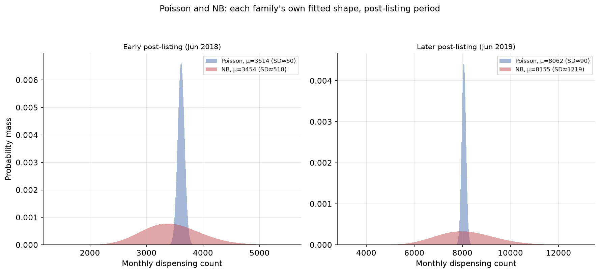
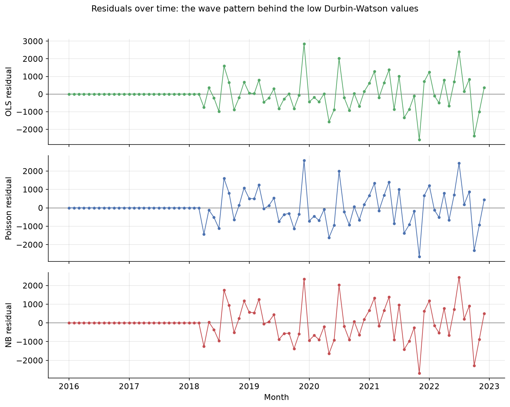
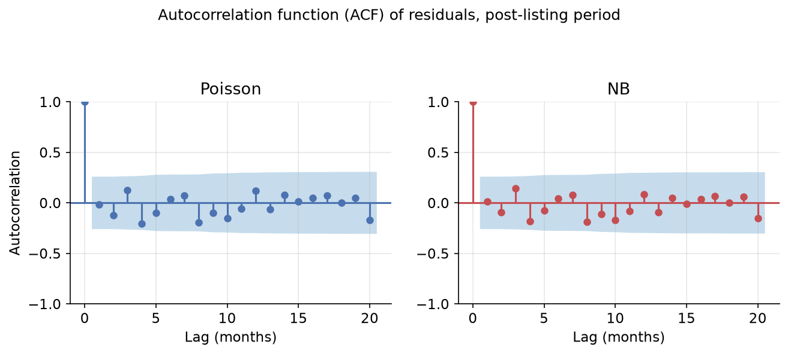

# Stage 1: Interrupted time series on PrEP dispensing

Sanity-check step in the project's four-stage causal design: using interrupted time
series as the identification strategy (see `docs/scope_and_rationale.md`), does PBS
PrEP dispensing show the level shift the project's causal argument depends on?

**NSW excluded.** Its EPIC-NSW trial ramp predates and dominates the national
pre-trend (see `reports/data_exploration_pbs_prep_dispensing.md` for why); this
report tests the rest-of-country aggregate instead.

## Data exploration

See `reports/data_exploration_pbs_prep_dispensing.md` for the full exploratory
analysis. Three patterns from that report motivate this specification directly:
post-listing growth is not a straight line, there is a clear COVID-19 dip in
2020, and NSW's EPIC-NSW early access dominates the national pre-trend before
the listing even happens. The early ramp and long-run growth terms, the COVID
decline-and-recovery terms, and rest-of-country aggregation in Model
specification below address each of these in turn.

## Model specification

Stage 1's initial specification (preserved in
`reports/stage1_initial_specification_diagnostics.md`) modelled the trajectory
as two segments, a pre-listing trend and a single post-listing trend, a 4-term
linear specification. Its own diagnostics showed this led to mixed,
inconclusive results, because the trajectory actually has more structure than
two segments can represent: the post-listing transition plays out over several
months rather than in one step, the 2020 COVID disruption has no term at all,
and NSW's EPIC-NSW ramp dominates the national pre-trend (see
`reports/data_exploration_pbs_prep_dispensing.md`).

**NSW excluded throughout** (see Table 1 below). This revised specification
models the trajectory as five segments instead of two, a 7-term linear
specification:

1. **Pre-listing trend** (January 2016 to March 2018): the baseline trend before the listing.
2. **Early ramp** (April 2018 to September 2019): a level shift at the listing
   date, then a steep slope while dispensing climbs to its new level.
3. **Long-run growth** (October 2019 to February 2020): the shallower slope
   dispensing settles into once the ramp is complete.
4. **COVID decline** (March 2020 to June 2020): a sharp fall to the observed
   trough, layered on top of the ongoing long-run growth.
5. **COVID recovery** (June 2020 to October 2021): the climb back, also layered
   on top of the ongoing long-run growth; growth continues at the long-run
   rate once the window ends.

Its linear predictor is:

```
η[t] = β0 + β1 * t + β2 * post_listing[t] + β3 * months_since_post_listing[t]
     + β4 * early_ramp[t] + β5 * covid_decline[t] + β6 * covid_recovery[t]
```

where:
- `η[t]`: the linear predictor for month t; how it maps to the actual predicted
  dispensing count depends on which family's link function is used.
- `t`: a running month index, 0, 1, 2, ..., 83 (January 2016 = 0).
- `post_listing[t]`: 1 if month t falls on or after April 2018, 0 otherwise.
- `months_since_post_listing[t]`: `post_listing[t] * (t - t at the first post-listing month)`,
  so it counts 0, 1, 2, ... after listing and stays at 0 throughout the pre-period.
- `early_ramp[t]`: `months_since_post_listing[t]` capped at 17. This length is
  data-derived, not assumed: `select_ramp_months()` grid-searches candidate
  lengths against AIC, the same "find it in the data" principle already used
  for the COVID trough below, rather than guessing where dispensing settles
  by eye. It keeps rising for the first 17 months after listing, then holds
  constant, giving that early transition its own, steeper slope.
- `months_since_covid_start[t]`: zero outside the COVID window (March 2020 to
  October 2021); inside it, counts 0, 1, 2, ... from the window's start.
- `covid_decline[t]`: `months_since_covid_start[t]` capped at 3, the point
  dispensing bottoms out in the rest-of-country series (June 2020, see Data
  exploration above); it rises for the first 3 months of the window, then holds
  constant for the rest of it.
- `covid_recovery[t]`: zero until that same month, then counts the months
  elapsed since it, capturing the climb back over the remainder of the window.

Coefficients:

- `β0`: fitted level at the start of the series (January 2016).
- `β1`: pre-existing linear trend: the change in dispensing per month before the listing.
- `β2`: level shift measured exactly at the listing date (April 2018).
- `β3`: the long-run linear trend dispensing settles into once the ramp is complete.
- `β4`: the extra slope during the ramp, on top of β3, while dispensing is still
  settling into its new level.
- `β5`: the decline's slope, the fall in dispensing over the three months
  leading up to the observed trough.
- `β6`: the recovery's slope, the climb back over the rest of the COVID window.

**Table 1.** Causal concepts mapped to this design's specification.

| Causal concept | What it is in this design |
|---|---|
| Treatment | The 1 April 2018 PBS listing |
| Treated unit | The rest-of-country dispensing series (NSW excluded, see above) |
| Comparison group | Not used in this design; ITS relies on the treated unit's own extrapolated pre-trend instead. Stage 2 uses one |
| Counterfactual | The pre-listing trend extrapolated forward: what dispensing would have been without the listing |
| Treatment effect | The gap between observed post-listing dispensing and the counterfactual: phased in via β2 and β4 over the ramp, then growing at the shallower β3 rate once settled; narrowed sharply by the COVID decline (β5) and partly closed again by the recovery (β6) |
| Estimand | The steady-state level shift, `β2 + 17 * β4`: the gap between the counterfactual and the level dispensing settles at once the post-listing transition is complete |



Each coefficient corresponds to a distinct visual feature of the segmented
regression: `β0` is where the pre-listing line meets t=0; `β1` is that line's
slope, near zero here, since the rest-of-country series is essentially flat
before the listing; `β2` is the vertical jump at the listing date. The
post-listing line then has two distinct slopes either side of the "ramp ends"
marker: `β4` is the steeper slope during the early ramp, and `β3` is the
shallower slope dispensing settles into once the ramp is complete. The grey
dotted line is the counterfactual from Table 1, the pre-listing trend extended
forward as if the listing had not happened; the shaded gap between it and the
post-listing line is the treatment effect. The solid fitted line layers in the
remaining controls, dropping sharply to the observed trough (`β5`) before
climbing back through the rest of the shaded COVID-19 window (`β6`).

**The estimand: the steady-state level shift.** The identification strategy
(interrupted time series) argues that a comparison of dispensing before and
after the listing supports a causal claim, provided nothing else plausibly
changed over that period (see the "Threat to identification" for this stage in
`docs/scope_and_rationale.md`). An estimand is the specific causal quantity
such a comparison is meant to recover, defined independently of which
coefficients or statistical family eventually estimate it.

Because dispensing climbs over several months before settling, rather than
jumping in one step (see Data exploration above), that quantity cannot be read
off `post_listing` alone: a discrete term at the listing date only captures
whichever fraction of the transition happens to land exactly on that month.
The estimand here is the steady-state level shift, the gap between the
counterfactual and the level dispensing settles at once the post-listing
transition is complete: `β2 + 17 * β4`. `β2` alone still has a reading, the
level shift measured exactly at the listing date, but it is not the estimand;
the steady-state level shift is.

### Full-series and post-listing fits, not three families on one dataset

The pre-listing period in this data is a verified, deterministic zero: the
raw PBS Item Report extract has no rows at all before the listing, these
item codes did not exist yet (see `reports/data_validation.md`).
That breaks Poisson and NB specifically: both use a log link, and a
multiplicative model meeting an exact-zero segment is degenerate, the
intercept is pushed toward -∞ and `post_listing` compensates with an
astronomical, uninterpretable coefficient (in the trillions). OLS is
unaffected, an additive model has no such difficulty with a zero baseline.

Rather than fabricate a non-zero pre-listing value to work around this, which
would trade a verified real figure for an assumption purely to satisfy a
different family's numerics, this report uses two fits for two different
questions:

- **The full series, OLS only**, for the steady-state level shift above,
  the question needing a real pre/post comparison. The verified zero is
  exactly what makes this comparison trustworthy; OLS is the only family
  that can use it directly.
- **The post-listing period only, Poisson and NB**, for characterising the
  post-period's own shape (the ramp, long-run growth, and COVID terms),
  where overdispersion-aware count families are the better choice and the
  zero-baseline problem does not arise, there is no zero in that subset to
  break them.

Model family selection below applies the Empirical comparison checklist to
each fit separately, since they are answering different questions on
different data, not one shared ranking.

## Model family selection

The Decision checklist in `docs/model_family_concepts.md` identifies Poisson and NB
as the plausible candidates for a non-negative count outcome; OLS is included
as a baseline, not because the checklist selects it. As explained above, this
now plays out as two separate fits, not one shared three-way comparison.

**Full series.** OLS is the only family usable on the full 84-month series
(AIC 1,382.1). Its own assumption check shows mild heteroskedasticity
(Breusch-Pagan LM = 13.05, p = 0.042, just below the conventional 0.05
threshold), and residual autocorrelation is no longer a material concern
(Durbin-Watson = 2.147, close to the ideal 2.0). Poisson and NB were also
fitted on this same data, only to confirm they fail as expected: both
produce the degenerate `post_listing` coefficient described above (Poisson
×33.0 trillion, NB ×21.3 trillion), and NB's own dispersion parameter
cannot be estimated with a finite confidence interval (α = 0.0222, 95% CI
[NaN, NaN]). Neither is used for anything beyond documenting this failure.

**Post-listing period.** Table 2 applies the Empirical comparison checklist
to Poisson and NB on the post-listing subset, where the zero-baseline
problem does not arise and both fit normally.

**Table 2.** Empirical comparison checklist results (Section 6), Poisson and
NB fitted on the post-listing period only (see Full-series and post-listing
fits above).

| Candidate | AIC | Assumption check | Autocorrelation check |
|---|---|---|---|
| Poisson | 8,816.1 | Pearson chi-squared / df = 155.92 | Durbin-Watson = 1.995 |
| NB | 978.6 | α = 0.0222, 95% CI [0.0140, 0.0304] | Durbin-Watson = 1.946 |

**1. Coefficients and their interpretation.** `months_since_post_listing` is
interpretable here, the long-run growth rate once the ramp is complete:
Poisson ×0.999 a month, NB ×0.998 a month, both essentially flat. This
matches Model specification above, where the same coefficient is not
statistically distinguishable from zero in the full-series OLS fit
(p = 0.931): dispensing settles into a plateau after the ramp rather than
continuing to climb.

**2. AIC.**

1. **NB**: rank 1 (978.6).
2. **Poisson**: rank 2 (8,816.1, 7,837.5 points higher, decisively ruled
   out).

**3. An assumption check specific to each candidate.**

1. **Poisson**: fail (Pearson chi-squared / df = 155.92, far above the 1.0
   expected if variance equalled the mean).
2. **NB**: pass (α = 0.0222, 95% CI [0.0140, 0.0304], excludes zero, so the
   extra dispersion it captures is real).



Figure 3 shows why: Poisson's fixed variance-equals-mean assumption gives it
an implausibly narrow spread (SD ≈ 60-90) against the real scatter in
monthly counts in the thousands; NB's own fitted dispersion (SD ≈ 520-1,220)
is far closer to what the data actually shows.

**4. Residual autocorrelation over time.**

1. **Poisson**: pass (Durbin-Watson = 1.995).
2. **NB**: pass (Durbin-Watson = 1.946).

Both sit close to the ideal 2.0, a material improvement on the initial
specification and on the full-series OLS fit's 1.092.



Figure 4 shows both candidates' residuals scattered around zero across the
post-listing period, with no sustained run on one side, consistent with the
Durbin-Watson values above.



Figure 5 confirms this: neither candidate's autocorrelation sits reliably
outside the confidence band at any lag out to 20 months, consistent with the
corrected, data-derived ramp length removing the omitted-structure problem
that drove the lower Durbin-Watson values seen before it was fixed.

**Family selection: Negative Binomial**, for the post-listing period's own
shape. NB wins decisively on AIC and passes its own assumption check;
Poisson is ruled out on both. This matches the Decision checklist's upfront
reasoning for a non-negative count outcome. The headline steady-state level
shift itself remains OLS's result, from the full series, for the reasons
set out above.

## Conclusion

The estimand, the steady-state level shift, is read from the full-series
OLS fit, the only family usable there (see Model family selection above):
dispensing settles at **9,507 more a month than the counterfactual** once
the 17-month ramp is complete (95% CI [8,419, 10,595], a direct combination
of `post_listing` and 17 × `early_ramp`'s standard errors; no bootstrap
needed, OLS's additive link makes this a plain sum rather than a
difference of two exponentials).

Stage 1's question, "did dispensing itself change sharply at the moment of
the PBS listing?", can be answered affirmatively at every level here. Taken
completely literally, yes: the discrete level-shift term measured exactly
at the listing date is itself highly significant (`post_listing` =
+2,483, p < 0.001). The fuller picture extends that further: a steeper rise
continues for 17 months after the listing (`early_ramp` = +413 a month,
p < 0.001), before settling into a much shallower long-run trend no longer
distinguishable from flat (`months_since_post_listing` = +2.1 a month,
p = 0.931). "Sharply" turns out to describe both an immediate jump and a
sustained climb over the following year and a half, not a single one-month
step, but every piece of that change is real, large, and tied unambiguously
to the listing date.

This answer is scoped to the rest of the country; NSW is excluded
throughout (see Table 1), since its EPIC-NSW trial access puts it on a
different, earlier trajectory this stage does not test.
